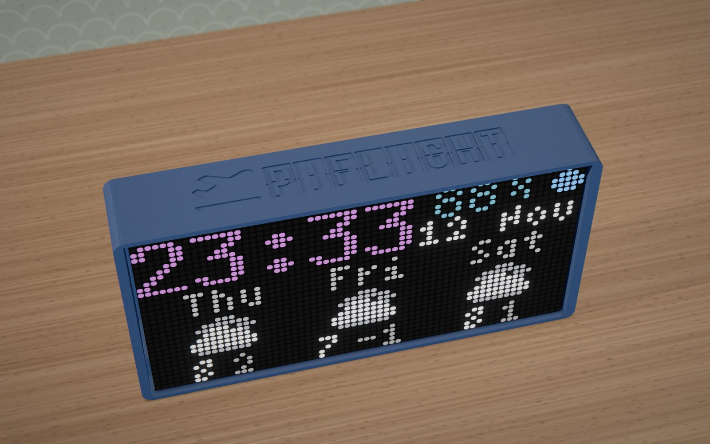
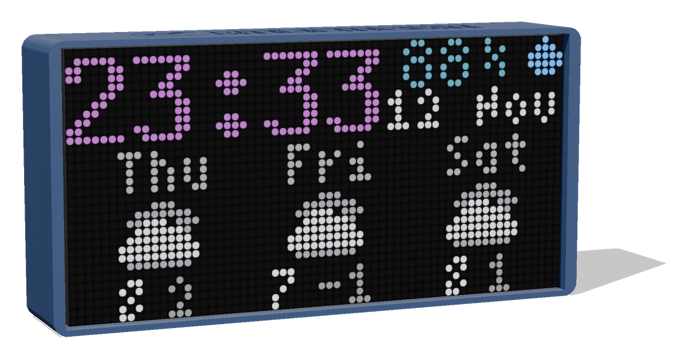
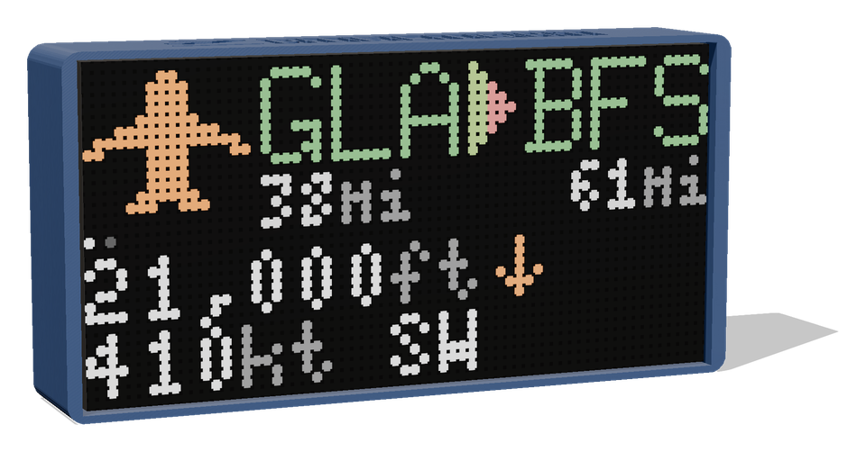
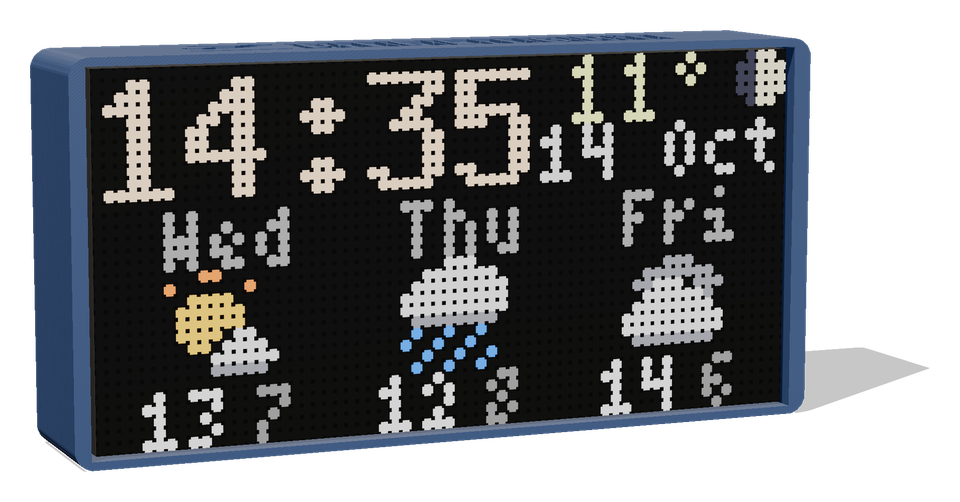
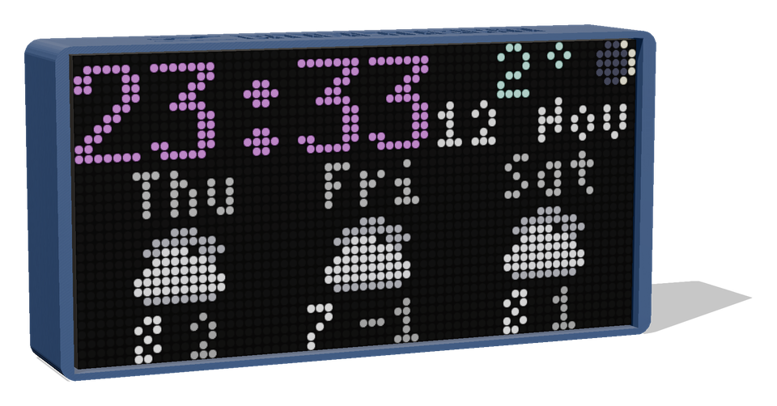
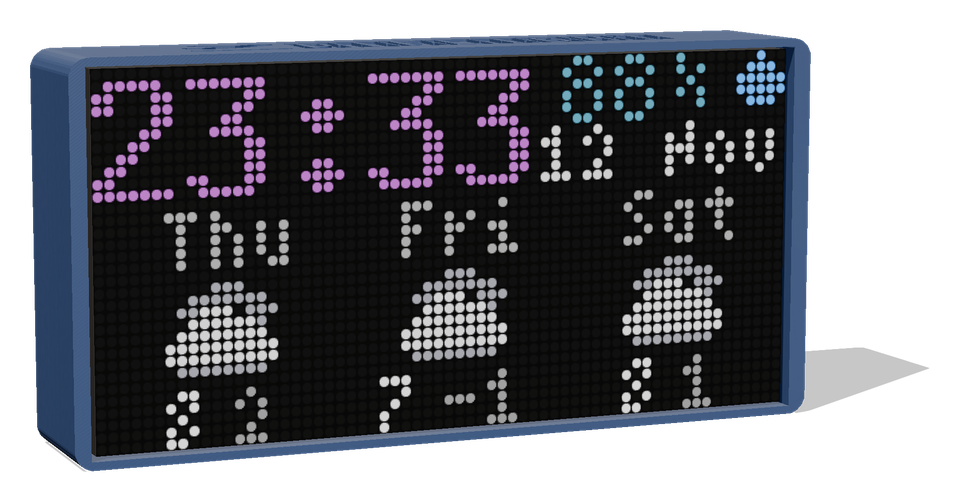
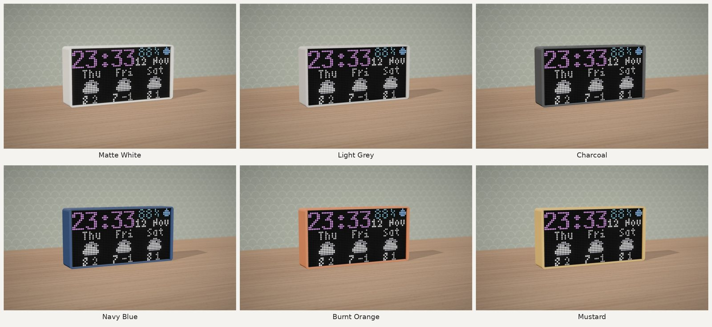

  <picture>
    <source media="(prefers-color-scheme: dark)" srcset="assets/logo-dark.svg">
    
  </picture>

<b>The planes over your home, on a little LED clock.</b> 
A 64×32 LED matrix and a Raspberry Pi that show what's flying overhead: where it's from and where it's going,
how high it is and how fast. Between planes, it shows the time and the weather.

  
  
  

## What it shows

|  |  |
|:---:|:---:|
| **A plane overhead.** Route and distances, altitude with climb or descent, speed and heading, airline and aircraft (and, with Flightradar24, its arrival time against the schedule) | **The clock.** Time, date, temperature and a three-day forecast with pixel-art weather icons |
|  |  |
| **At night.** The clock changes colour through the day (pick from four schemes) and the brightness drops at night. The corner shows the moon's phase. | **Humidity.** Every 10 seconds the corner swaps between temperature and humidity |

There are two display styles. **Modern** shows still pages with hand-drawn airline logos. **Classic** shows scrolling text.

**Flight data** comes from free open networks, [adsb.lol](https://adsb.lol) and [adsb.fi](https://adsb.fi), taking turns so
piFlight checks about every 45 seconds with no key, and backing each other up. You can also use your own ADS-B
receiver on your home network (readsb, dump1090, PiAware or tar1090), or your own Flightradar24 API key.
You can switch between them in the dashboard.

## The dashboard

Everything is set up from a phone or computer, at **http://piflight.local**:
- **Home:** a live picture of the panel, its log, and a power test for checking your power supply.
- **Zone:** drop a pin on your home and choose how far around it to look.
- **Stats:** the planes you've seen this week or month. It shows top airlines, aircraft, routes and airports, the time of day planes pass, and records.
- **Settings:** the weather service (Open-Meteo by default), brightness by day and at night, a screen-off schedule, 12 or 24-hour time, and units.
- **Wi-Fi**, **Software update** and **Remote access**.

## Colours

The case is 3D-printed in matte white, light grey, charcoal, navy blue, burnt orange or mustard.
There's a 3D model of the navy case in [`assets/piflight-navy.glb`](assets/piflight-navy.glb). You can open it in
Windows 3D Viewer, Blender or any glTF viewer online.

## Get started

You'll need:
- a Raspberry Pi 3 Model A+;
- a 64×32 HUB75 LED panel (P4 indoor, 1/16 scan);
- an Adafruit RGB Matrix Bonnet;
- a 32 GB microSD card;
- a 5 V supply that can deliver at least 3 A.

### Flash the SD card
1. Download `piflight-<version>-<date>.img.xz` from [Releases](../../releases). To check the download, compare
   its SHA-256 with the `.sha256` file.
2. Flash it with [Raspberry Pi Imager](https://www.raspberrypi.com/software/): *Choose OS → Use custom*, pick
   the `.img.xz` file and choose the card. When Imager asks about **OS customisation, choose "No"**, because
   piFlight sets itself up.
3. Put the card in the Pi and switch it on. The first start takes about 2 minutes and restarts once.
4. The panel shows a QR code. Scan it, or join the Wi-Fi network **PiFlight-Setup** (password `PiFlight`).
5. Open http://192.168.4.1 and log in with the password shown on the login page. You will be asked to
   change it.
6. Add your home Wi-Fi on the **Wi-Fi** page. The Pi joins it, and the dashboard is then at
   http://piflight.local.
7. On the **Zone** page, put the pin on your home. In **Settings**, choose your weather service and enter its
   API key if it needs one.

### Power
At full brightness the panel can draw more than 2.5 A, and a thin wire is enough to make the Pi report
under-voltage. What works well:
- **Run separate wires to the panel and to the Bonnet.** Feed the panel's power lead straight from your 5 V
  supply, and the Bonnet, which powers the Pi, from its own pair of wires. Use short, thick wires, 0.75 mm² (18 AWG) or more.
- **Keep the supply at 5.1–5.25 V.** If you use a USB-C PD trigger and a buck converter, set the converter with a meter.
- **Test it:** dashboard → **Home → Display → Power test** lights the whole panel for a few minutes. The Pi
  should stay at 4.9 V or above and show no under-voltage.

## Updating
On the dashboard, go to **Software update → Check for update → Install**. The Pi downloads the latest
release from here, installs it, and checks that everything still runs. If it doesn't, the Pi switches back
by itself.

Without internet on the Pi, download the `piflight-update-<version>.pfu` file from a release and use
**Install from a file** on the same card.

Updates are signed: a piFlight device only installs files made with the piFlight release key. Re-flashing
an SD card with a newer image also works, but you then have to set the device up again.

## Privacy and remote access
- **There is no shared or hidden login.** SSH is off, and the Pi's user account has no password until you
  choose one. Nobody else, including the piFlight author, can log in to your device.
- To use SSH yourself: dashboard → **Remote access**. Choose a password, optionally add your public key and
  refuse password logins ("Keys only"). Switch it off again on the same page.
- **Need help?** Use **Download diagnostics** on the same page and send the text file to whoever is helping you.
  It contains versions, temperature, service status and recent logs. Wi-Fi names and passwords, API keys and
  your location are left out, and you can read the whole file before you send it.
- **Counting piFlights (optional, asked once):** if you say yes, your piFlight checks in once a day with a
  random ID made on the device, its version, its display style and how many planes it has shown. Nothing else
  is sent: no location, Wi-Fi, settings or flights. The counter keeps only a salted hash of the ID and stores
  no IP addresses. You can switch it off any time in Settings. The counter's code is at
  [piflight-counter](https://github.com/s1dave-web/piflight-counter).
- **What the Pi connects to:**
  - the flight data sources you tick (adsb.lol, adsb.fi, your own receiver, or Flightradar24), for planes in your
    area, and adsb.lol's route files and adsbdb.com for routes and aircraft details;
  - your weather provider;
  - time servers (pool.ntp.org, Cloudflare, Google);
  - a ping to 8.8.8.8 / 1.1.1.1, to check the internet is up;
  - GitHub, only when you check for updates;
  - the counter, only if you said yes.

  The dashboard page loads its map tiles and two scripts straight into your browser.

---

piFlight isn't affiliated with adsb.lol, adsb.fi, Flightradar24 or any airline. Airline names and logos belong to their owners.
